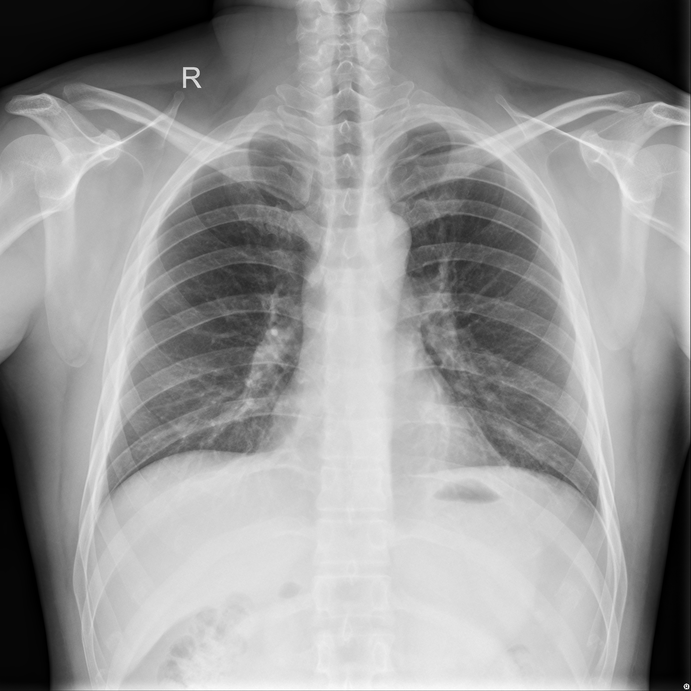
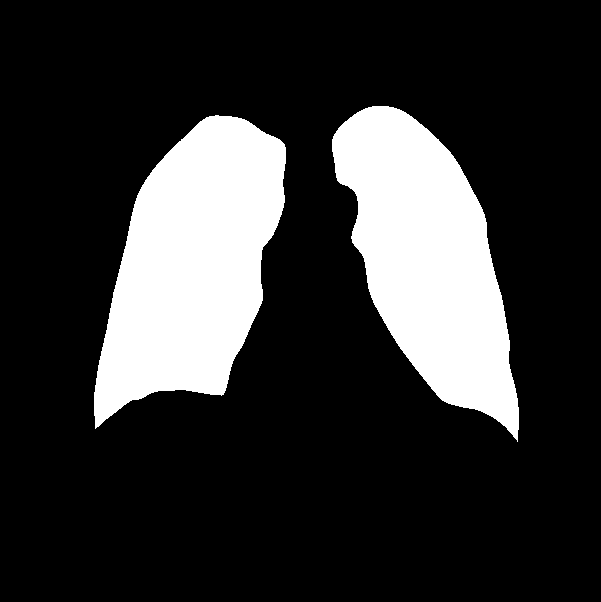

# Chest X-ray Lung Segmentation Competition

## About the Competition

Welcome to the **Chest X-ray Lung Segmentation Challenge!**

The goal of this competition is to develop a deep learning model that can automatically identify and segment the lung regions in chest X-ray images.
Participants will use the provided training data to build and evaluate their segmentation models and generate predictions for the unseen test images.
This competition focuses on **Binary Semantic Segmentation**.

For each test image, participants must predict a binary segmentation mask that identifies the lung regions and separates them from the background.

- **Lung pixels:** 1
- **Background pixels:** 0

The predicted masks will be compared with the ground-truth masks using the **Dice Similarity Coefficient (DSC)** to evaluate segmentation performance.

## Dataset

The **Chest X-ray Dataset for Tuberculosis Segmentation** contains **704 chest X-ray images** collected from two sources:

- **Montgomery County Chest X-ray Database (USA)**
- **Shenzhen Chest X-ray Database (China)**

The dataset includes both **tuberculosis (TB)-positive and normal chest X-ray images**. Each image is accompanied by a corresponding **lung segmentation mask**, which identifies the lung regions.

Additional clinical and demographic information, including age, gender, and country of origin, is also provided.

The dataset is sourced from Kaggle: [Chest X-ray Lungs Segmentation](https://www.kaggle.com/datasets/iamtapendu/chest-x-ray-lungs-segmentation)

Examples of the Chest X-Ray images and its masks:

<table center>
  <tr>
    <td>
      
    </td>
    <td>
      
    </td>
  </tr>
</table>


## Evaluation

The submissions will be evaluated using the Dice Score.
Dice Similarity Coefficient (DSC): Measures the overlap between the predicted segmentation mask and the ground-truth mask. It ranges from 0 to 1, where 1 indicates a perfect match and 0 indicates no overlap. Higher Dice scores indicate better segmentation performance.

**Formula:**

$$\text{Dice} = \frac{2 |A \cap B|}{|A| + |B|}$$

Where:
- `A` represents the predicted mask.
- `B` represents the ground-truth mask.


## Baseline

A U-Net implementation is provided as a starting point.


## Submission

**_Ready to compete?_** 
Follow these steps to get your model on the leaderboard!
* Each participant must fork this repository to their GitHub account.
* Each participant needs to use the provided starter code as a baseline and implement your model (while respecting all constraints!).
* After generating predictions on the test set, convert the predicted masks into RLE format using the provided code and save them in your_team_name_submission.csv.:\
   image_id,encoded_mask .
* Ensure:
    The file contains predictions for all test nodes.\
    The order of IDs matches test.\
    The file name is your_team_name_submission.csv
* To ensure fair evaluation, all submissions must be encrypted before being uploaded. Use the provided public key:
 ```
python encryption/encrypt.py your_team_name_submission.csv 
```
This generates: your_team_name_submission.csv.enc
* Move the encrypted .enc file into the submissions/ folder, commit and push your changes and open a Pull Request to the main repository.
* Once your Pull Request is opened:\
    Your submission will be automatically evaluated.\
    The score will be computed using the hidden test labels.\
    Your result will be added to the leaderboard.

 🌟Higher scores climb higher🌟
  
## 🏆Leaderboard
The competition features a **dynamic, automatically updated leaderboard**.
* All scores are stored and displayed in real-time on docs/leaderboard.html.
* Participants are ranked according to the official evaluation metric (Dice metric).
* Each entry shows: Rank, Team Name, Score, and Submission Date.
* The leaderboard updates automatically whenever a valid submission is made via a Pull Request, no manual intervention is needed.

✨Watch your team climb the ranks as you submit! 


## Rules

1. Use the provided training dataset.
2. Do not access or attempt to reconstruct hidden test masks.
3. Follow the required mask submission format.
4. External datasets and pretrained models must be disclosed.
5. Respect the dataset's original license and terms.

## Repository Structure

- `src/`: Dataset preparation, models and evaluation.
- `notebooks/`: Experiments and visualizations.
- `configs/`: Training configurations.
- `docs/`: Competition documentation.


## Contact

For questions, use the GitHub Issues section.
